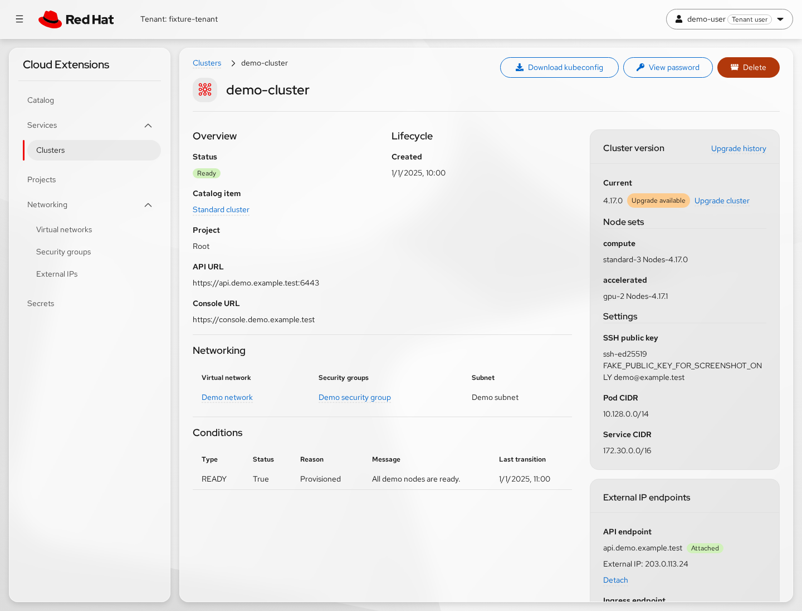
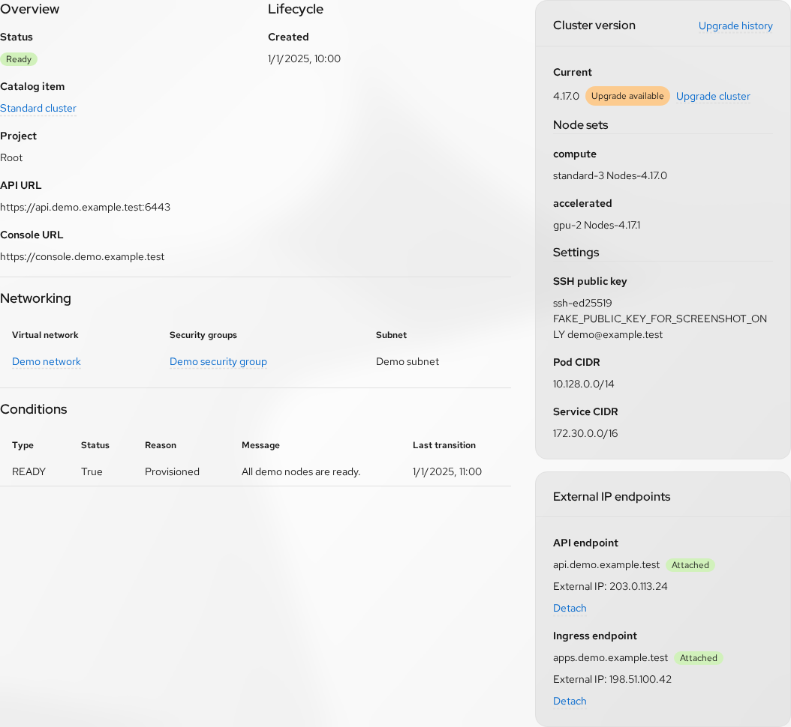
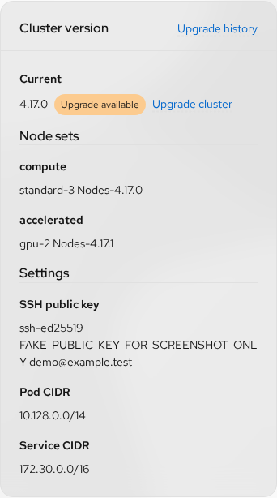

# Cluster details — native PatternFly description lists

Source: `5292d4c102ae0558bb387c010f5dea3e9aaf465a`.

These images show the actual production frontend with authored synthetic demo
fixtures, not a live deployment. The production styles and application DOM are
unmodified; no screenshot-specific styles, reference elements or CSS-ablation
changes are applied during capture.

## Desktop overview

Full viewport capture at 1440 × 1100: Cluster header and actions, plaintext Root
project, Overview/Lifecycle, and independent detail columns. Property groups use
native compact PatternFly description-list fonts and colors.

## Desktop detail sections

Detail-grid crop from a 1440 × 1100 viewport: networking references, Conditions,
native secondary cards, and each endpoint's own attached address. Node sets use
name/summary description groups without row borders; subsection and structural
section dividers remain visible.

## Mobile version card

Version-card crop from a 390 × 1100 viewport, not a full mobile-screen image:
Current version, Upgrade history, native Node sets descriptions, and Settings.

All visible names and data are invented demo fixtures. Hostnames use reserved
`example.test`, displayed external addresses use documentation ranges, and the
SSH public-key text is explicitly fake. No real tenant, customer, credentials,
browser storage or live infrastructure data is included.
